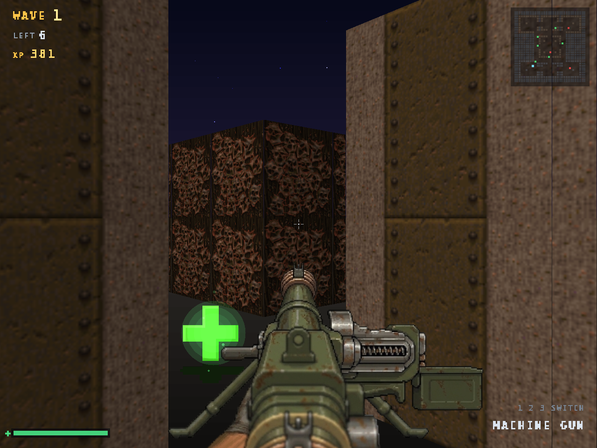
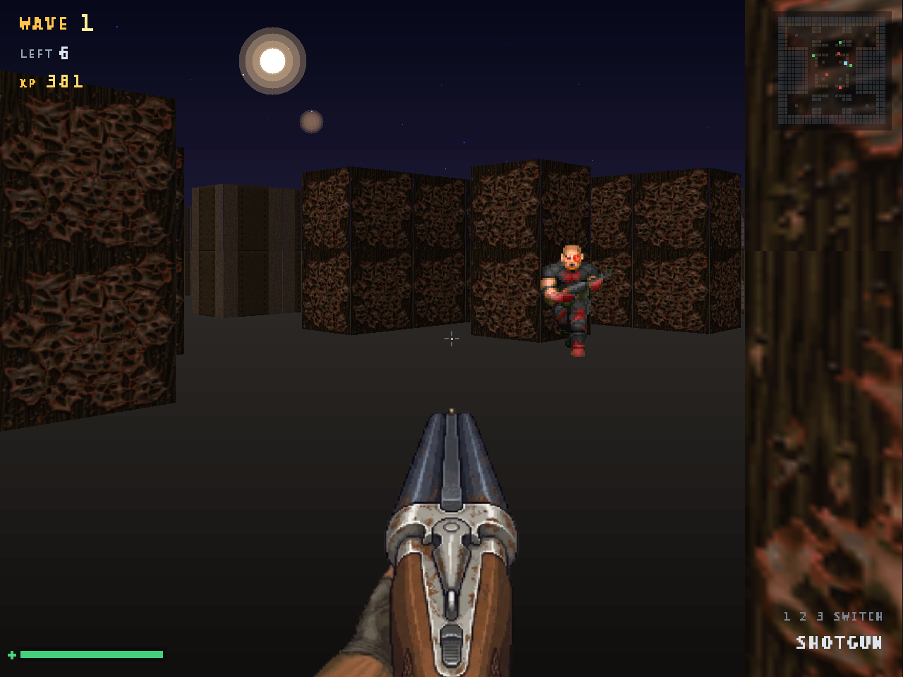
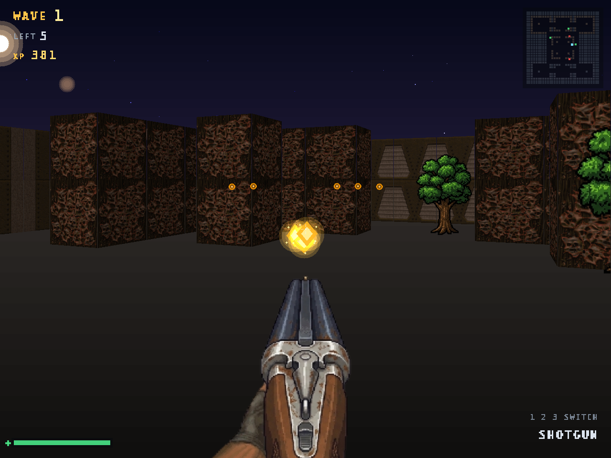
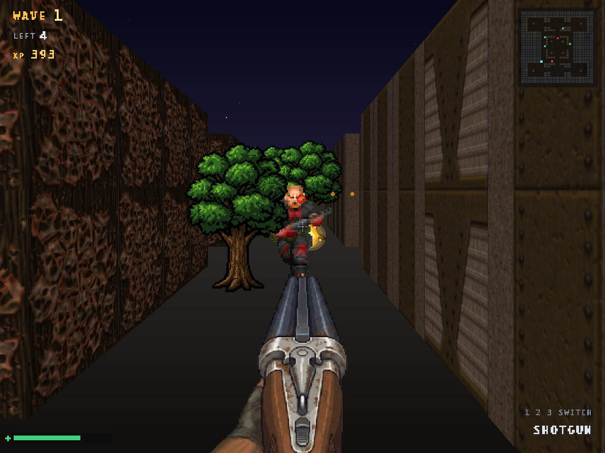
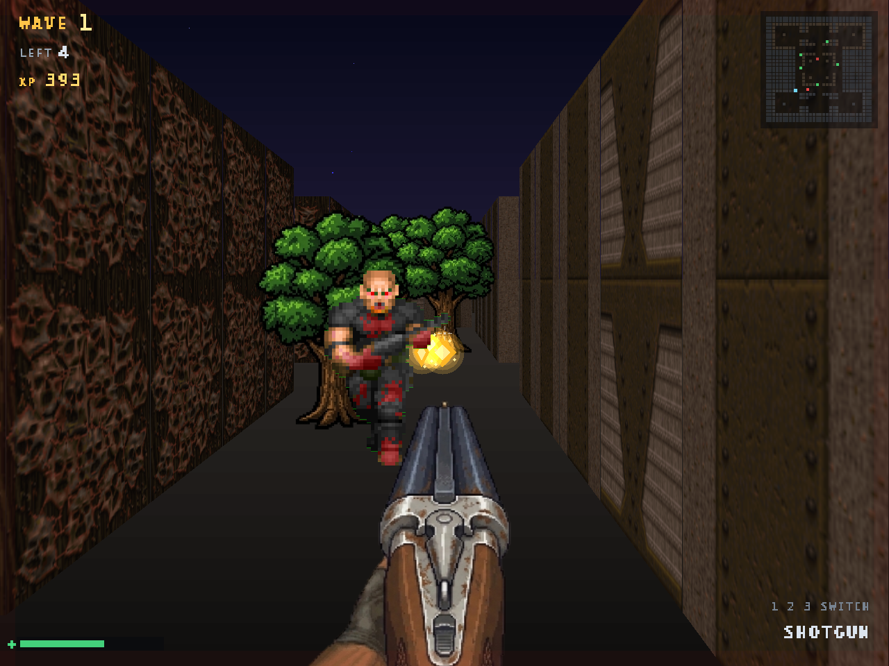

## cubedoom

This is a lightweight arena shooter, initially consisting of under 1000 LOC, and raycasting rendering.

To build, clone this repository, and install:

- The [Spectre Programming Language](https://github.com/spectrelang/spectre) Toolchain
- SDL2 Dev Dependency (libsdl2-dev)
- SDL2_Image Dev Dependency (libsdl2-image-dev)

And run `spectre build release`

License: GPL-3.0-only - By Navid M
